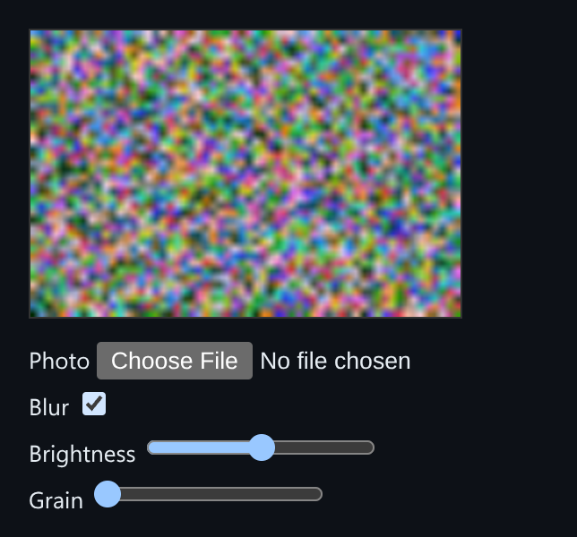

# WebGL Filter Pipeline

Chain image effects (blur, curves, grain) as WebGL fragment shaders, with ping-pong framebuffers.



*The demo with the blur pass enabled on the generated source image.*

## Features

- Each effect is **its own fragment shader**.
- Passes **ping-pong between two offscreen framebuffer textures**, so no draw call reads and writes the same texture.
- The **final pass renders straight to the visible canvas**.
- The demo has a **real file input** for your own photo, and starts from a generated image.

## How it works

Pass N reads the texture pass N-1 wrote to, and writes to whichever of the two textures isn't the current input.

## Usage

```ts
const pipeline = new FilterPipeline(canvas, sourceCanvas);
pipeline.render([
  { name: 'blur', uniforms: { uTexelSize: [1/w, 1/h] } },
  { name: 'curves', uniforms: { uBrightness: 0.1, uContrast: 1.2 } },
  { name: 'grain', uniforms: { uAmount: 0.08 } },
]);
```

## Run it

```bash
npx esbuild FilterPipeline.ts --bundle --format=esm --outfile=FilterPipeline.js
```

```html
<div id="app"></div>
<script type="module">
  import { mount } from './FilterPipeline.js';
  mount(document.getElementById('app'));
</script>
```

There are no runtime dependencies: just the DOM and browser APIs.

## Files

| File | Purpose |
| --- | --- |
| [`FilterPipeline.ts`](FilterPipeline.ts) | Module plus a `mount()` demo |
| [`preview.png`](preview.png) | Screenshot of the running demo |
