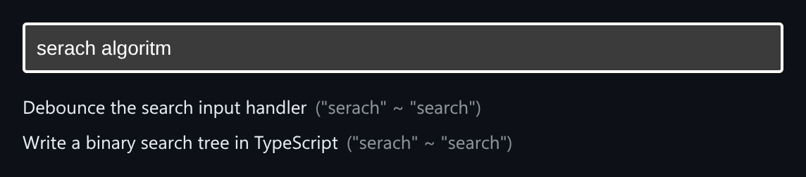

# Fuzzy Search Index

A client-side inverted index with typo-tolerant ranking.



*Searching "serach algoritm" still finds the "search" documents.*

## Features

- Builds an **inverted index** (token to document ids).
- **Exact token hits** score highest.
- **Typos** are matched by **Levenshtein edit distance**, scoring lower the further they drift.
- Results show which typed word matched which indexed word.
- `buildIndex` and `search` are exported for use outside the demo.

## How it works

Each query token is looked up exactly first. If that fails, it is compared against indexed tokens within a small edit distance, and documents are scored by the sum of their best matches.

## Usage

```ts
import { mount } from './FuzzySearchIndex';
mount(document.getElementById('app'));
```

## Run it

```bash
npx esbuild FuzzySearchIndex.ts --bundle --format=esm --outfile=FuzzySearchIndex.js
```

```html
<div id="app"></div>
<script type="module">
  import { mount } from './FuzzySearchIndex.js';
  mount(document.getElementById('app'));
</script>
```

There are no runtime dependencies: just the DOM and browser APIs.

## Files

| File | Purpose |
| --- | --- |
| [`FuzzySearchIndex.ts`](FuzzySearchIndex.ts) | Module plus a `mount()` demo |
| [`preview.png`](preview.png) | Screenshot of the running demo |
