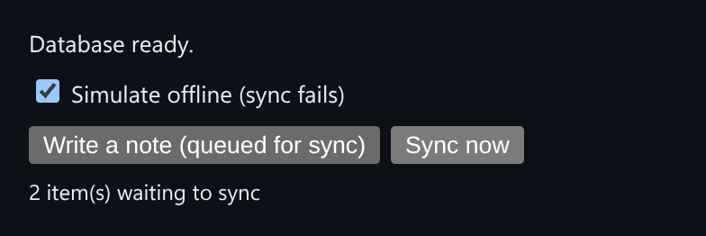

# IndexedDB Offline Cache

A typed IndexedDB store with TTLs, incremental migrations and a durable offline sync queue.



*With "Simulate offline" checked, two notes stay queued after a failed sync.*

## Features

- **Per-entry TTLs**, checked and cleaned up lazily on read.
- **Incremental schema migrations**: opening a v1 database with a v1+v2 list runs only the new v2 step.
- A **durable sync queue** in its own object store that **survives a reload**.
- `flush(send)` replays the queue, and **only failed entries stay queued**.

## How it works

Writes made while offline are queued in IndexedDB. On flush, each entry is sent through a function you supply, and only the ones that succeed are removed.

## Usage

```ts
const db = await openDatabase('myapp', MIGRATIONS);
const cache = new TypedStore<string>(db, 'cache');
await cache.set('token', 'abc', 60_000); // expires in 60s
const queue = new SyncQueue(db);
await queue.enqueue('note:1', { text: 'hi' });
await queue.flush(async (item) => sendToServer(item));
```

## Run it

```bash
npx esbuild IndexedDbCache.ts --bundle --format=esm --outfile=IndexedDbCache.js
```

```html
<div id="app"></div>
<script type="module">
  import { mount } from './IndexedDbCache.js';
  mount(document.getElementById('app'));
</script>
```

There are no runtime dependencies: just the DOM and browser APIs.

## Files

| File | Purpose |
| --- | --- |
| [`IndexedDbCache.ts`](IndexedDbCache.ts) | Module plus a `mount()` demo |
| [`preview.png`](preview.png) | Screenshot of the running demo |
