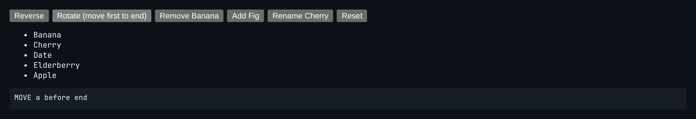

# Keyed List Diff

A mini virtual-DOM keyed list reconciler that keeps DOM moves to a minimum.



*"Rotate" moves one item: a single MOVE, not five re-inserts.*

## Features

- Computes a patch list of **REMOVE / INSERT / MOVE / UPDATE** operations.
- Uses the **longest increasing subsequence** of old indices to find the items that can stay where they are.
- Applies moves **back to front with a running anchor**, so `insertBefore` is always correct.
- The demo shows the patch list for each change.

## How it works

Items in the LIS are already in relative order and never move. Everything else gets a single MOVE. This is the same trick real frameworks use.

## Usage

```ts
const ops = diffKeyedList(oldItems, newItems);
applyKeyedList(ulElement, newItems, ops, domMap);
```

## Run it

```bash
npx esbuild KeyedDiff.ts --bundle --format=esm --outfile=KeyedDiff.js
```

```html
<div id="app"></div>
<script type="module">
  import { mount } from './KeyedDiff.js';
  mount(document.getElementById('app'));
</script>
```

There are no runtime dependencies: just the DOM and browser APIs.

## Files

| File | Purpose |
| --- | --- |
| [`KeyedDiff.ts`](KeyedDiff.ts) | Module plus a `mount()` demo |
| [`preview.png`](preview.png) | Screenshot of the running demo |
