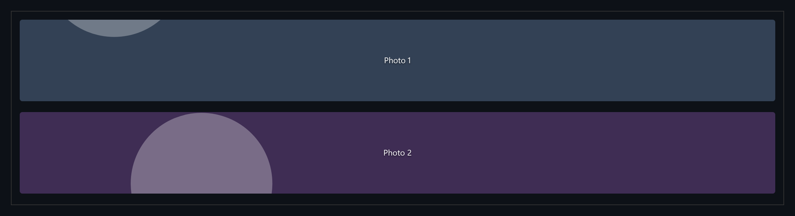

# Lazy Image

Lazy-loaded images with viewport prefetching and decoding off the main thread.



*The scrolling demo list with colour placeholders.*

## Features

- Each image starts as a **blurred colour placeholder**.
- An IntersectionObserver with a generous **rootMargin prefetches** images before they scroll into view.
- Images are **decoded with `img.decode()`** and faded in only after decoding finishes.

## How it works

Setting `src` and fading in immediately can flash an undecoded frame on a slow device. Waiting for `decode()` avoids that.

## Usage

```ts
const el = createLazyImage({ src: 'photo.jpg', color: '#334' });
observer.observe(el);
```

## Run it

```bash
npx esbuild LazyImage.ts --bundle --format=esm --outfile=LazyImage.js
```

```html
<div id="app"></div>
<script type="module">
  import { mount } from './LazyImage.js';
  mount(document.getElementById('app'));
</script>
```

There are no runtime dependencies: just the DOM and browser APIs.

## Files

| File | Purpose |
| --- | --- |
| [`LazyImage.ts`](LazyImage.ts) | Module plus a `mount()` demo |
| [`preview.png`](preview.png) | Screenshot of the running demo |
