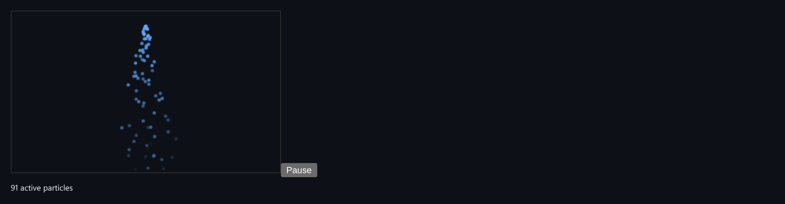

# Particle Engine

A pooled canvas particle system stepped on a deterministic fixed timestep.



*The live canvas with an active emitter.*

## Features

- Particles are **pre-allocated once** and switched on and off, with no garbage-collection churn.
- Configurable **emitters** and **forces**: gravity, drag, wind.
- A **fixed-timestep accumulator**, so the same total time gives the same state however the frames arrived.
- A seeded PRNG (`mulberry32`) for reproducible runs.

## How it works

Real frame time feeds an accumulator, and the simulation advances in constant steps drawn from it. Stepping by the raw frame delta would not be deterministic.

## Usage

```ts
const sim = new Simulation(300, { gravity: 200, drag: 0.5, wind: 0 });
sim.addEmitter({ x: 0, y: 0, rate: 30, angleRange: [0, Math.PI*2], speedRange: [20,60], lifeRange: [1,2] }, mulberry32(1));
sim.advance(dtSeconds); // call every animation frame
```

## Run it

```bash
npx esbuild ParticleEngine.ts --bundle --format=esm --outfile=ParticleEngine.js
```

```html
<div id="app"></div>
<script type="module">
  import { mount } from './ParticleEngine.js';
  mount(document.getElementById('app'));
</script>
```

There are no runtime dependencies: just the DOM and browser APIs.

## Files

| File | Purpose |
| --- | --- |
| [`ParticleEngine.ts`](ParticleEngine.ts) | Module plus a `mount()` demo |
| [`preview.png`](preview.png) | Screenshot of the running demo |
