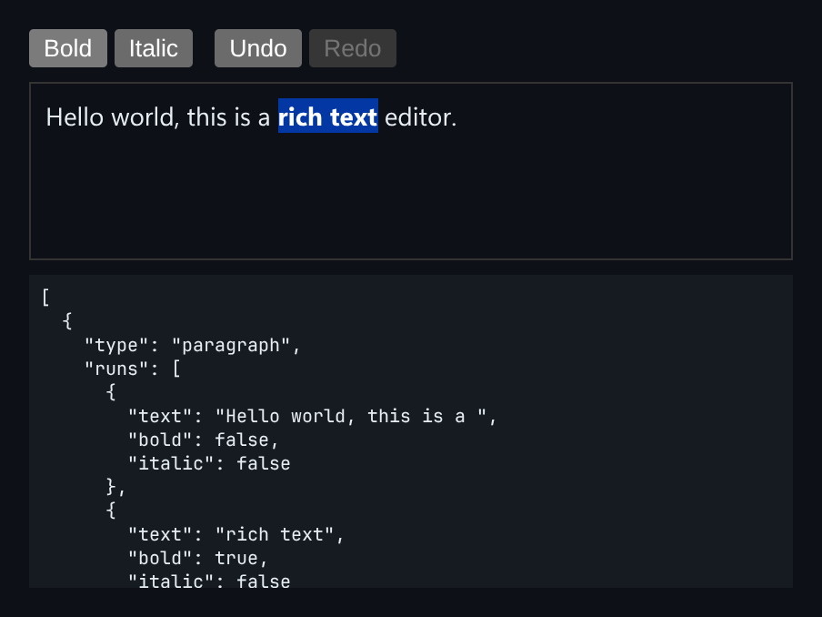

# Rich Text Editor

A contenteditable editor that formats by walking the real Selection Range, not `execCommand`.



*"rich text" made bold, with the model below showing the new bold run.*

## Features

- **Bold and italic** wrap the selected Range in `<strong>` or `<em>`, or unwrap it.
- The DOM is serialised into a **document model**: paragraphs of runs, each with its own flags.
- **Undo snapshots** after each command and after a pause in typing, not on every keystroke.
- `serialize`, `toggleFormat` and `Editor` are exported.

## How it works

`document.execCommand` is deprecated and gives you no control over its markup. Working on Ranges directly gives a clean, inspectable model.

## Usage

```ts
mount(document.getElementById('app'));
```

## Run it

```bash
npx esbuild RichTextEditor.ts --bundle --format=esm --outfile=RichTextEditor.js
```

```html
<div id="app"></div>
<script type="module">
  import { mount } from './RichTextEditor.js';
  mount(document.getElementById('app'));
</script>
```

There are no runtime dependencies: just the DOM and browser APIs.

## Files

| File | Purpose |
| --- | --- |
| [`RichTextEditor.ts`](RichTextEditor.ts) | Module plus a `mount()` demo |
| [`preview.png`](preview.png) | Screenshot of the running demo |
