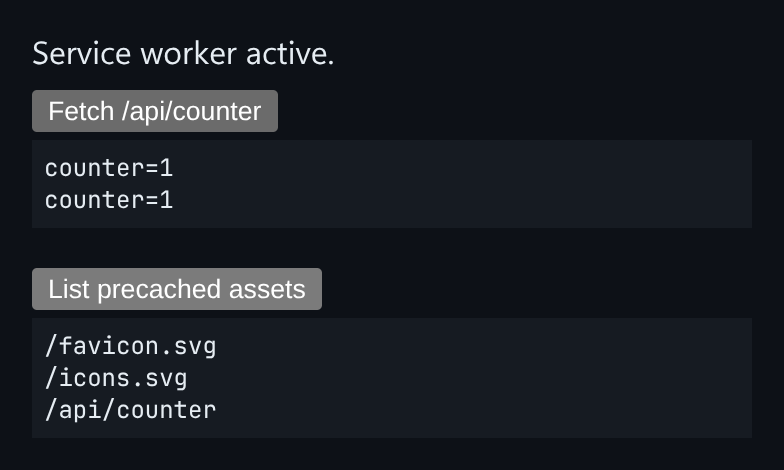

# Service Worker Precacher

One file that works both as a service worker and as the page that registers it.



*The worker is active: the counter is served stale-while-revalidate, and the precached assets are listed.*

## Features

- **Precaches a manifest** on `install`.
- **Drops old cache versions** on `activate`.
- `skipWaiting()` and `clients.claim()`, so updates take over immediately.
- Serves assets **cache-first**.
- `/api/counter` is genuine **stale-while-revalidate**: it answers from cache and refreshes in the background.

## How it works

The same module checks its global scope. As a worker it installs the lifecycle handlers, and as a page module, `mount()` registers it and drives the demo.

## Usage

```ts
navigator.serviceWorker.register('/sw-loader.ts', { type: 'module' });
```

## Run it

```bash
npx esbuild ServiceWorkerPrecacher.ts --bundle --format=esm --outfile=ServiceWorkerPrecacher.js
```

```html
<div id="app"></div>
<script type="module">
  import { mount } from './ServiceWorkerPrecacher.js';
  mount(document.getElementById('app'));
</script>
```

There are no runtime dependencies: just the DOM and browser APIs.

## Files

| File | Purpose |
| --- | --- |
| [`ServiceWorkerPrecacher.ts`](ServiceWorkerPrecacher.ts) | Module plus a `mount()` demo |
| [`preview.png`](preview.png) | Screenshot of the running demo |
