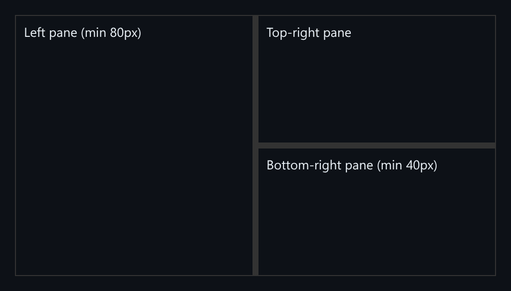

# Split Panes

Recursive split panes resized with pointer capture, with ratios saved per split.



*A horizontal split whose right side is a vertical split.*

## Features

- A **recursive pane tree**: a horizontal split can contain a vertical split.
- Drag resizing with **pointer capture**, so a fast drag that outruns the divider keeps working.
- Each divider **respects both panes' minimum sizes**.
- Ratios are **saved to localStorage** per split id and restored on mount.

## How it works

Once the divider captures the pointer, it receives move events wherever the cursor goes. The new ratio is clamped to the two panes' minimums and saved.

## Usage

```ts
mount(document.getElementById('app'));
```

## Run it

```bash
npx esbuild SplitPanes.ts --bundle --format=esm --outfile=SplitPanes.js
```

```html
<div id="app"></div>
<script type="module">
  import { mount } from './SplitPanes.js';
  mount(document.getElementById('app'));
</script>
```

There are no runtime dependencies: just the DOM and browser APIs.

## Files

| File | Purpose |
| --- | --- |
| [`SplitPanes.ts`](SplitPanes.ts) | Module plus a `mount()` demo |
| [`preview.png`](preview.png) | Screenshot of the running demo |
