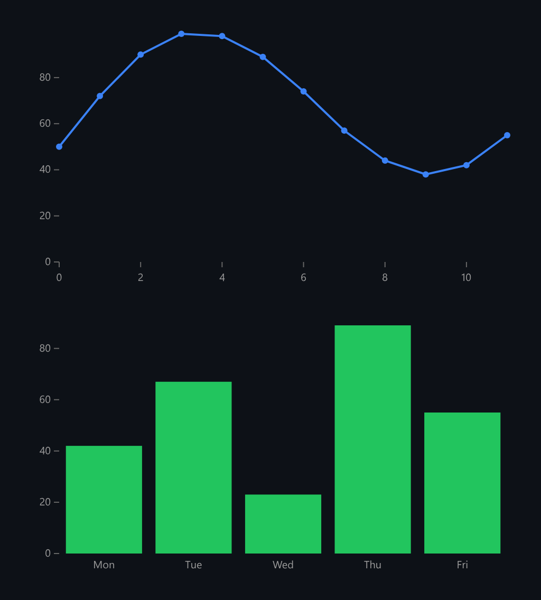

# SVG Charts

A small SVG chart library: linear and band scales, nice round ticks, and line and bar charts.



*A line chart and a bar chart rendered by the demo.*

## Features

- **Linear** and **band** scales.
- A **nice-round-number tick generator** (0, 20, 40, …).
- **Line** and **bar** renderers in plain SVG DOM, with no dependencies.
- Scales map onto whatever range you pass, including a **flipped y range**.

## How it works

Pixel y grows downwards, but data y usually shouldn't. Passing `[height, 0]` as the range makes larger values land higher on screen.

## Usage

```ts
import { mount } from './SvgCharts';
mount(document.getElementById('app'));
```

## Run it

```bash
npx esbuild SvgCharts.ts --bundle --format=esm --outfile=SvgCharts.js
```

```html
<div id="app"></div>
<script type="module">
  import { mount } from './SvgCharts.js';
  mount(document.getElementById('app'));
</script>
```

There are no runtime dependencies: just the DOM and browser APIs.

## Files

| File | Purpose |
| --- | --- |
| [`SvgCharts.ts`](SvgCharts.ts) | Module plus a `mount()` demo |
| [`preview.png`](preview.png) | Screenshot of the running demo |
