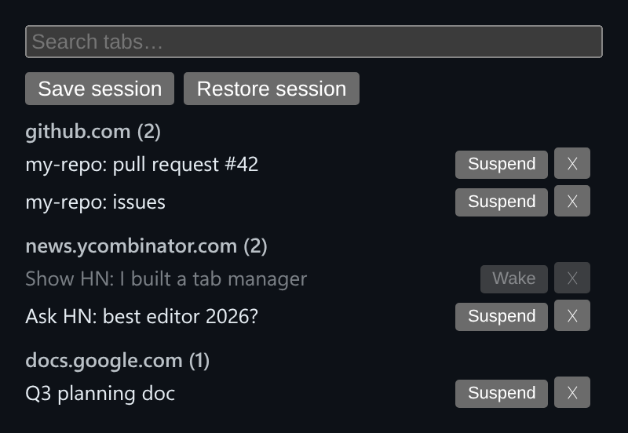

# Tab Manager

Tab-manager logic as a browser extension would run it: group by domain, search, suspend, and save sessions.



*Tabs grouped by domain, with one suspended.*

## Features

- **Groups tabs by domain.**
- **Search** filters across titles and URLs.
- **Suspend** discards a tab to free memory without closing it, and Wake restores it.
- **Save and restore** a full session snapshot to localStorage.

## How it works

The tab list is an in-memory stand-in for `chrome.tabs`, but the grouping, search, suspend and session logic is what an extension's background script would run.

## Usage

```ts
const manager = createTabManager(seedTabs);
manager.groupsByDomain();
manager.saveSession();
manager.restoreSession();
```

## Run it

```bash
npx esbuild TabManager.ts --bundle --format=esm --outfile=TabManager.js
```

```html
<div id="app"></div>
<script type="module">
  import { mount } from './TabManager.js';
  mount(document.getElementById('app'));
</script>
```

There are no runtime dependencies: just the DOM and browser APIs.

## Files

| File | Purpose |
| --- | --- |
| [`TabManager.ts`](TabManager.ts) | Module plus a `mount()` demo |
| [`preview.png`](preview.png) | Screenshot of the running demo |
