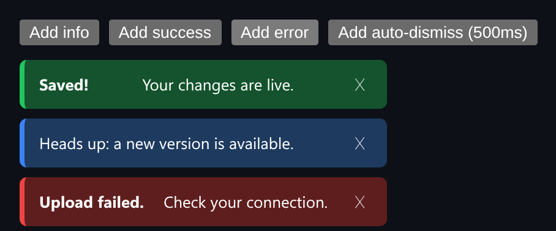

# Toast Web Component

A framework-free `<toast-item>` custom element with Shadow DOM, slots and ARIA announcements.



*Info, success and error toasts stacked in the demo host page.*

## Features

- An **open Shadow DOM** with **slotted content**: write normal HTML as children.
- An **ARIA live region**, so screen readers announce each toast.
- **CSS custom properties** for theming, and an optional **auto-dismiss** timer.
- Fires a bubbling **`toast-dismiss` event** that crosses the shadow boundary.

## How it works

Dismissing by button or timer dispatches a composed CustomEvent, so host code can react without reaching into the shadow tree.

## Usage

```ts
customElements.define('toast-item', ToastItem);
const t = document.createElement('toast-item');
t.setAttribute('type', 'success');
t.setAttribute('duration', '4000');
t.innerHTML = '<strong>Saved!</strong> Your changes are live.';
document.body.appendChild(t);
```

## Run it

```bash
npx esbuild ToastElement.ts --bundle --format=esm --outfile=ToastElement.js
```

```html
<div id="app"></div>
<script type="module">
  import { mount } from './ToastElement.js';
  mount(document.getElementById('app'));
</script>
```

There are no runtime dependencies: just the DOM and browser APIs.

## Files

| File | Purpose |
| --- | --- |
| [`ToastElement.ts`](ToastElement.ts) | Module plus a `mount()` demo |
| [`preview.png`](preview.png) | Screenshot of the running demo |
