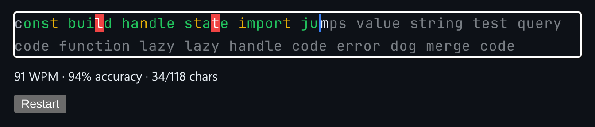

# Typing Test

A typing speed test with live WPM, accuracy, and a speed heatmap for each keystroke.



*Partway through a passage: speed colours, two mistakes in red, and live stats.*

## Features

- **Times every keystroke.**
- **Live WPM and accuracy** as you type.
- A **heatmap**: each character is coloured by how long it took relative to the previous one.
- A **Copy results** button for sharing.

## How it works

Plain DOM and browser APIs, no framework. Each keystroke stores a timestamp, and both the stats and the colours are calculated from those times.

## Usage

```ts
import { mount } from './TypingTest';
mount(document.getElementById('app'));
```

## Run it

```bash
npx esbuild TypingTest.ts --bundle --format=esm --outfile=TypingTest.js
```

```html
<div id="app"></div>
<script type="module">
  import { mount } from './TypingTest.js';
  mount(document.getElementById('app'));
</script>
```

There are no runtime dependencies: just the DOM and browser APIs.

## Files

| File | Purpose |
| --- | --- |
| [`TypingTest.ts`](TypingTest.ts) | Module plus a `mount()` demo |
| [`preview.png`](preview.png) | Screenshot of the running demo |
