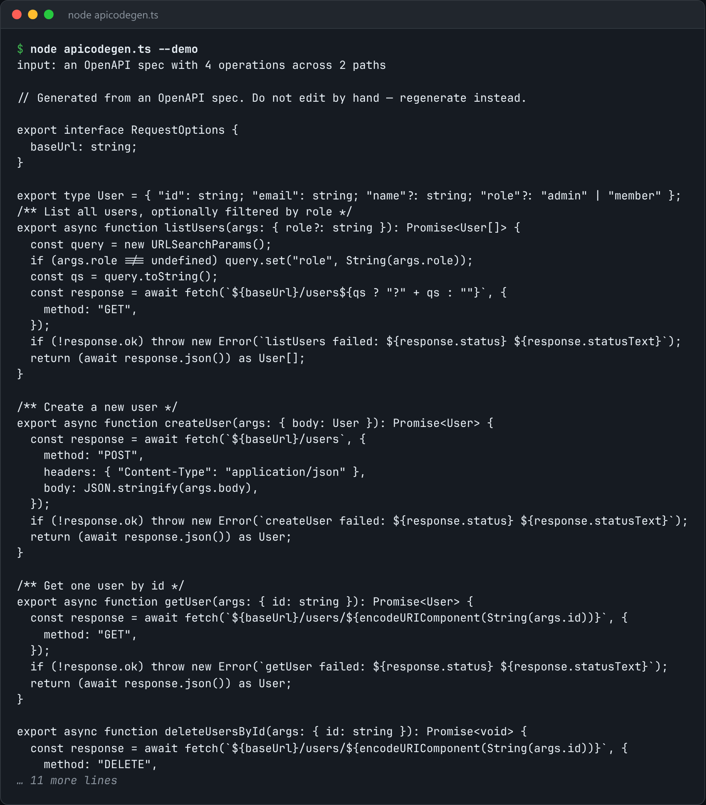

# OpenAPI Client Codegen

Turn an OpenAPI spec into typed fetch functions with narrowed response types.



*Real output of `node apicodegen.ts --demo`.*

## Features

- **One function per operation**, named from `operationId`, or derived from the method and path when it's missing.
- A **parameter object** for path params, query params and body.
- The **return type** is built from the 2xx response schema, so calls get real autocomplete instead of `any`.
- Path params are substituted with a template literal, with no routing library.

## How it works

Schemas are converted to TypeScript types recursively, `$ref` included, and each operation becomes a small typed `fetch` wrapper.

## Usage

```bash
node apicodegen.ts openapi.json --out client.ts
node apicodegen.ts --demo
```

## Run it

```bash
node apicodegen.ts --demo
```

Needs Node.js 22.18+ (or 23.6+), which runs TypeScript directly. It uses only `node:` built-ins, so there is no `npm install`.

## Files

| File | Purpose |
| --- | --- |
| [`apicodegen.ts`](apicodegen.ts) | The complete program |
| [`preview.png`](preview.png) | Captured output of a real run |
