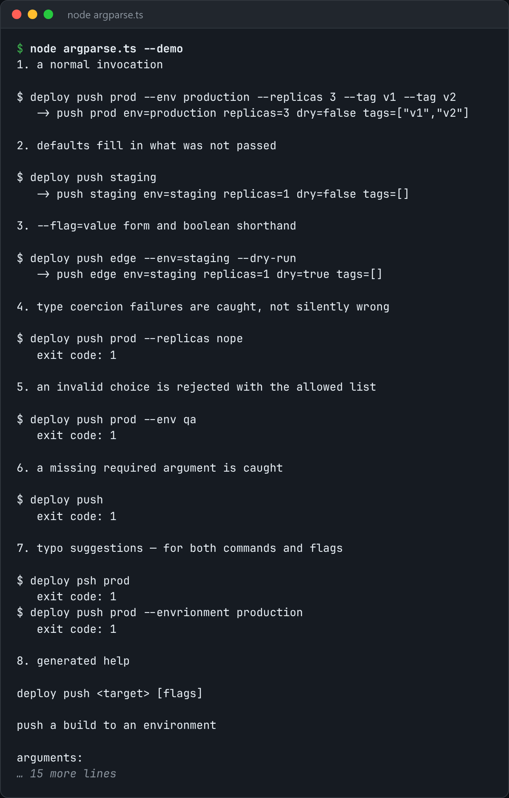

# Argument Parser

A CLI argument parser with subcommands, typed flags, generated help, and useful errors for typos.



*Real output of `node argparse.ts --demo`.*

## Features

- Flags are **typed** (string, number, boolean or array) and **coerced or rejected loudly**.
- **Subcommands**, positionals (including variadic ones), aliases, defaults, required flags and `choices`.
- **Generated help** text.
- Unknown flags get **"did you mean --output?"** suggestions by edit distance.

## How it works

Each spec drives both the parsing and the help output. A caller never gets a string where they expected a number.

## Usage

```bash
node argparse.ts --demo
```

## Run it

```bash
node argparse.ts --demo
```

Needs Node.js 22.18+ (or 23.6+), which runs TypeScript directly. It uses only `node:` built-ins, so there is no `npm install`.

## Files

| File | Purpose |
| --- | --- |
| [`argparse.ts`](argparse.ts) | The complete program |
| [`preview.png`](preview.png) | Captured output of a real run |
