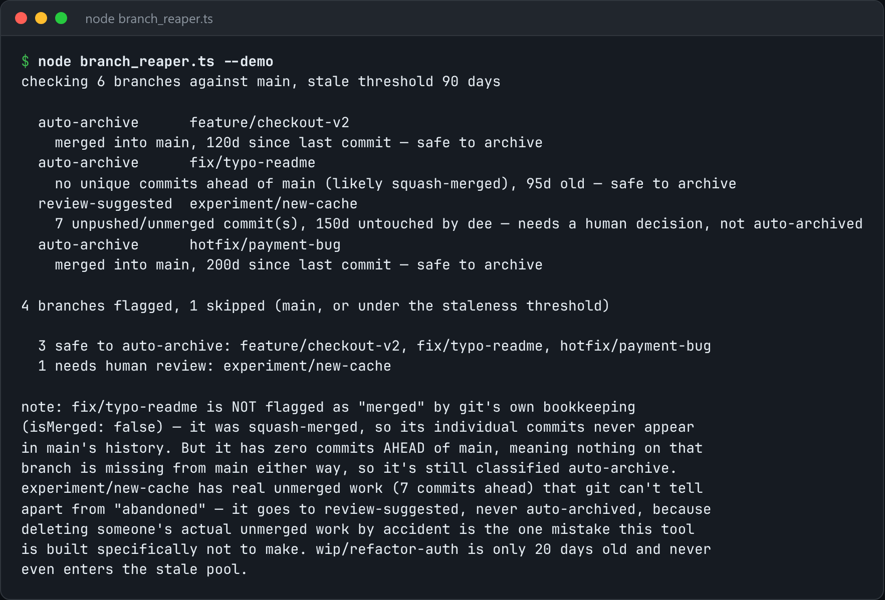

# Branch Reaper

Find branches that are merged or untouched for months, and archive them safely.



*Real output of `node branch_reaper.ts --demo`.*

## Features

- **Archives instead of deleting**: tags the branch as `refs/archive/<name>-<date>` before removing it.
- The commits **stay reachable**, and `git branch -a` stays clean.
- **Merged** branches are archived. **Old but unmerged** branches are only flagged for review.
- `--stale-days` sets the age threshold.

## How it works

"Nobody touched it in 90 days" and "this work was abandoned" are not the same claim, so only merged branches are archived automatically.

## Usage

```bash
node branch_reaper.ts --stale-days 90
node branch_reaper.ts --demo
```

## Run it

```bash
node branch_reaper.ts --demo
```

Needs Node.js 22.18+ (or 23.6+), which runs TypeScript directly. It uses only `node:` built-ins, so there is no `npm install`.

## Files

| File | Purpose |
| --- | --- |
| [`branch_reaper.ts`](branch_reaper.ts) | The complete program |
| [`preview.png`](preview.png) | Captured output of a real run |
