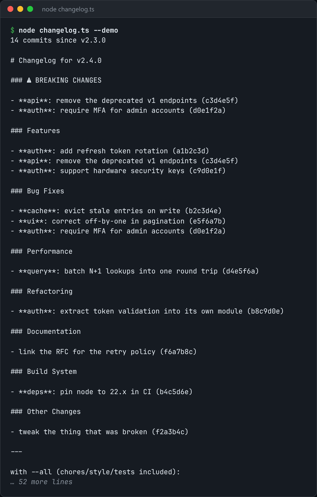

# Changelog Generator

Turn conventional commits since the last tag into grouped release notes.



*Real output of `node changelog.ts --demo`.*

## Features

- Groups commits by **Conventional Commits type** (feat, fix, …).
- Orders groups by how much a reader cares: **breaking changes and features first**, chores last.
- Sorts each group **newest first**.
- Commits that don't follow the convention go under **"Other changes"**, never dropped.

## How it works

It reads `git log` since the last tag and parses each header. `--demo` uses a synthetic history, so no git repo is needed.

## Usage

```bash
node changelog.ts                    # uses real git log in this repo
node changelog.ts --demo             # synthetic commit history, no git needed
```

## Run it

```bash
node changelog.ts --demo
```

Needs Node.js 22.18+ (or 23.6+), which runs TypeScript directly. It uses only `node:` built-ins, so there is no `npm install`.

## Files

| File | Purpose |
| --- | --- |
| [`changelog.ts`](changelog.ts) | The complete program |
| [`preview.png`](preview.png) | Captured output of a real run |
