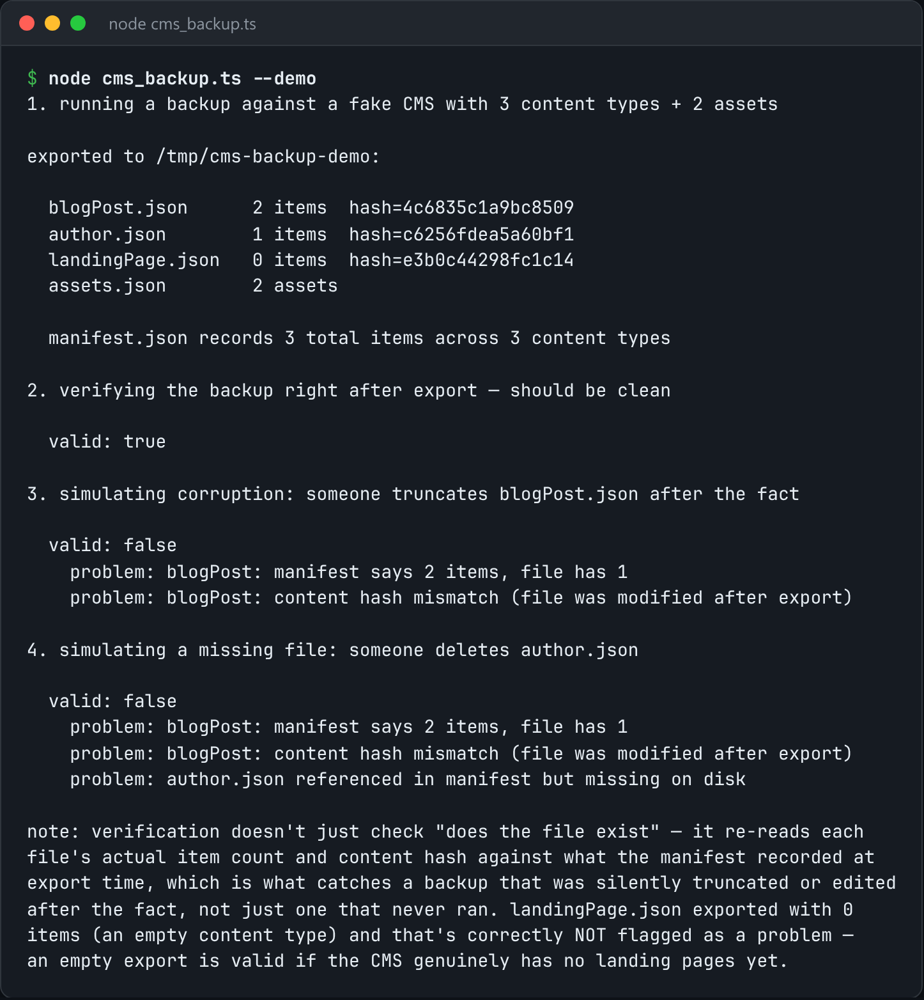

# CMS Backup

Export content and assets from a headless CMS on a schedule, with a manifest you can restore from.



*Real output of `node cms_backup.ts --demo`.*

## Features

- Writes **one file per content type**.
- A **manifest** with the export timestamp, item counts and a **content hash for each type**.
- You can **verify a backup is complete** without calling the API again.

## How it works

A directory of JSON files isn't restorable unless someone remembers the shape the API expects. The manifest records it.

## Usage

```bash
node cms_backup.ts export --api https://cms.example.com/api --token $TOKEN --out ./backups
node cms_backup.ts --demo
```

## Run it

```bash
node cms_backup.ts --demo
```

Needs Node.js 22.18+ (or 23.6+), which runs TypeScript directly. It uses only `node:` built-ins, so there is no `npm install`.

## Files

| File | Purpose |
| --- | --- |
| [`cms_backup.ts`](cms_backup.ts) | The complete program |
| [`preview.png`](preview.png) | Captured output of a real run |
