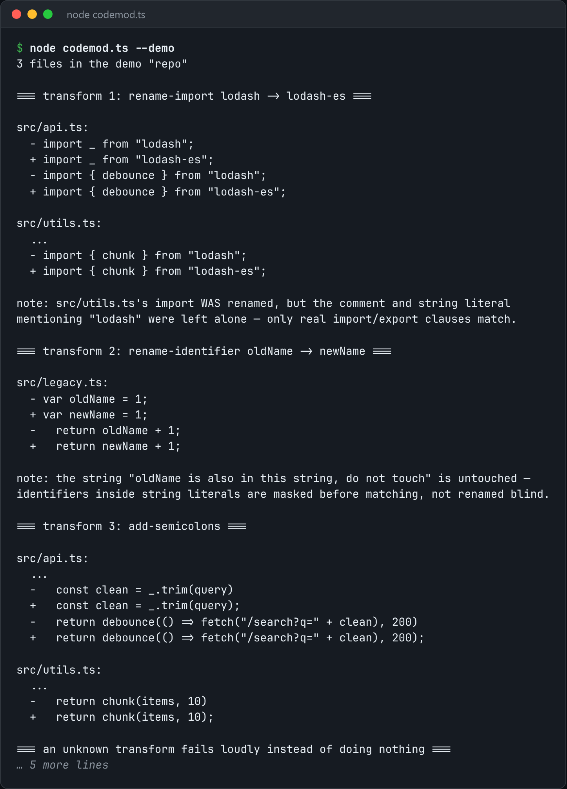

# Codemod

Apply source-to-source transforms across a repo, with a preview diff and per-file undo.



*Real output of `node codemod.ts --demo`.*

## Features

- **Skips string and comment regions** before matching, unlike `sed`.
- **Shows the diff before writing** anything unless you pass `--write`.
- Keeps a **byte-for-byte backup** of every touched file, restorable with `--undo`.
- Built-in transforms such as `rename-import:lodash=lodash-es`.

## How it works

Each line is masked so only code outside strings and comments is eligible for matching. Then the transform runs and a unified diff is printed.

## Usage

```bash
node codemod.ts ./src --transform rename-import:lodash=lodash-es --write
node codemod.ts --demo
```

## Run it

```bash
node codemod.ts --demo
```

Needs Node.js 22.18+ (or 23.6+), which runs TypeScript directly. It uses only `node:` built-ins, so there is no `npm install`.

## Files

| File | Purpose |
| --- | --- |
| [`codemod.ts`](codemod.ts) | The complete program |
| [`preview.png`](preview.png) | Captured output of a real run |
