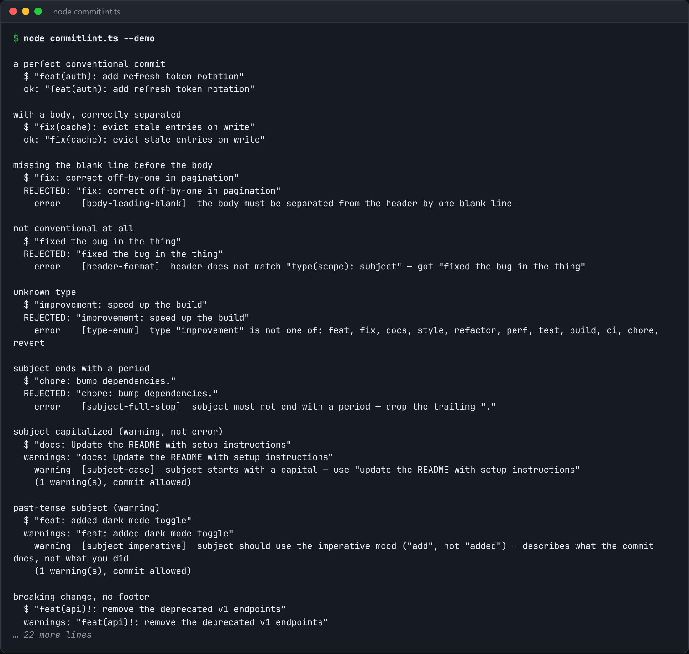

# Commit Lint

Enforce Conventional Commits as a git hook, with errors that tell you how to fix the message.



*Real output of `node commitlint.ts --demo`.*

## Features

- Parses the header against the spec exactly: `type(scope)!: subject`.
- Every failure **names the rule and the fix** ("subject must not end with a period").
- Body and footer checks (line length, blank-line separation, BREAKING CHANGE format) **run only when those parts exist**.
- Drops in as a `commit-msg` hook.

## How it works

The message is split into header, body and footer. Each rule returns a message describing a fix, not just pass or fail.

## Usage

```bash
node commitlint.ts .git/COMMIT_EDITMSG
node commitlint.ts --demo
git config core.hooksPath .githooks   # then drop this at .githooks/commit-msg
```

## Run it

```bash
node commitlint.ts --demo
```

Needs Node.js 22.18+ (or 23.6+), which runs TypeScript directly. It uses only `node:` built-ins, so there is no `npm install`.

## Files

| File | Purpose |
| --- | --- |
| [`commitlint.ts`](commitlint.ts) | The complete program |
| [`preview.png`](preview.png) | Captured output of a real run |
