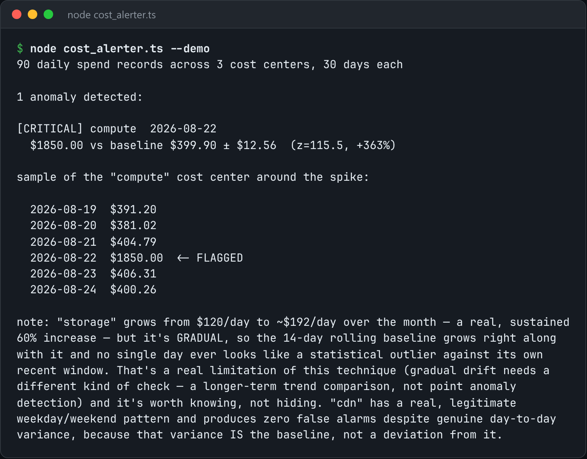

# Cloud Cost Alerter

Compare daily cloud spend to a rolling baseline and alert on real outliers.



*Real output of `node cost_alerter.ts --demo`.*

## Features

- A **rolling baseline** (mean and standard deviation over a trailing window) **per cost centre**.
- Flags a day only when it is **several standard deviations out**.
- Doesn't fire on "higher than yesterday", which is true about half the time.

## How it works

A flat "$X" threshold either fires every Black Friday or misses a real leak in a quiet month. A z-score against the cost centre's own history avoids both.

## Usage

```bash
node cost_alerter.ts check --data spend.json
node cost_alerter.ts --demo
```

## Run it

```bash
node cost_alerter.ts --demo
```

Needs Node.js 22.18+ (or 23.6+), which runs TypeScript directly. It uses only `node:` built-ins, so there is no `npm install`.

## Files

| File | Purpose |
| --- | --- |
| [`cost_alerter.ts`](cost_alerter.ts) | The complete program |
| [`preview.png`](preview.png) | Captured output of a real run |
