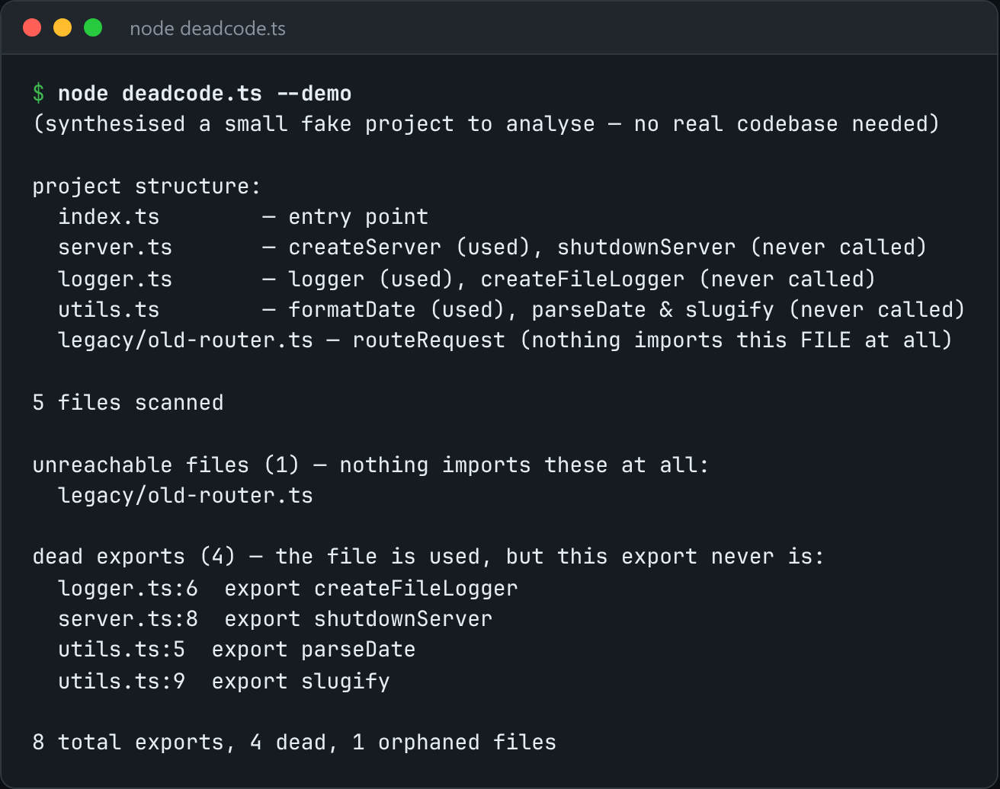

# Dead Code Finder

Trace exports from entry points and list what nothing ever imports.



*Real output of `node deadcode.ts --demo`.*

## Features

- A **regex-based import/export scanner** that builds a real module graph without a compiler.
- Walks every `import` edge **reachable from the entry points**.
- Handles **named imports, `import *`, and re-exports**.
- Lists **unused exports** and **files nothing imports at all**.

## How it works

Each exported symbol is marked as used the moment anything reachable imports it. Whatever is still unmarked after the walk is dead.

## Usage

```bash
node deadcode.ts ./src --entry src/index.ts
node deadcode.ts --demo
```

## Run it

```bash
node deadcode.ts --demo
```

Needs Node.js 22.18+ (or 23.6+), which runs TypeScript directly. It uses only `node:` built-ins, so there is no `npm install`.

## Files

| File | Purpose |
| --- | --- |
| [`deadcode.ts`](deadcode.ts) | The complete program |
| [`preview.png`](preview.png) | Captured output of a real run |
