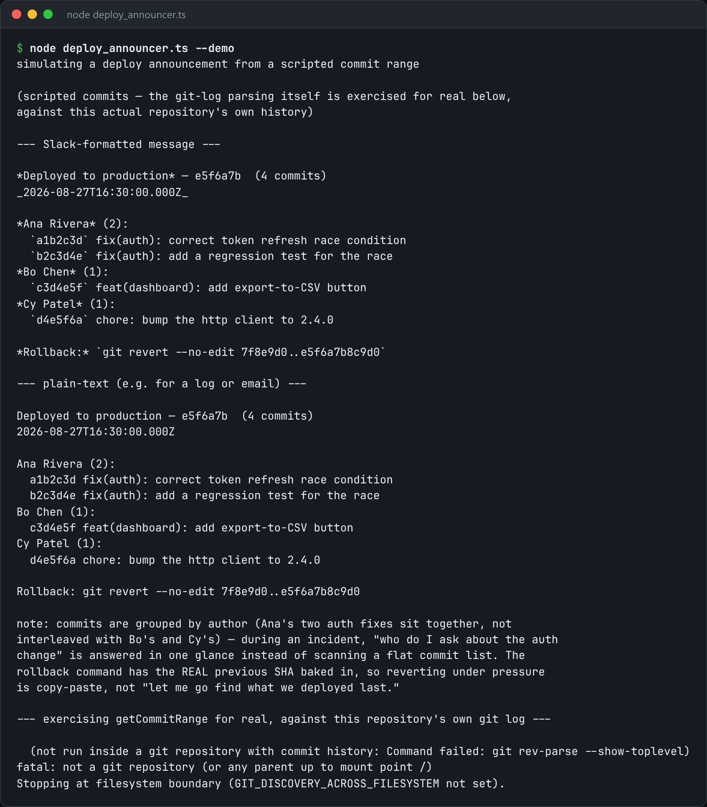

# Deploy Announcer

Post a deploy announcement with the commit range, the authors, and a ready-to-run rollback command.



*Real output of `node deploy_announcer.ts --demo`.*

## Features

- Builds the **commit range** from git: the previous deploy tag to HEAD.
- **Groups commits by author**, so you know who to ask.
- Pre-fills the **rollback command with the real previous SHA**.
- Posts to a Slack webhook.

## How it works

During an incident, the useful announcement says exactly what changed, who to ask, and the one command that undoes it.

## Usage

```bash
node deploy_announcer.ts announce --env production --webhook $SLACK_WEBHOOK_URL
node deploy_announcer.ts --demo
```

## Run it

```bash
node deploy_announcer.ts --demo
```

Needs Node.js 22.18+ (or 23.6+), which runs TypeScript directly. It uses only `node:` built-ins, so there is no `npm install`.

## Files

| File | Purpose |
| --- | --- |
| [`deploy_announcer.ts`](deploy_announcer.ts) | The complete program |
| [`preview.png`](preview.png) | Captured output of a real run |
