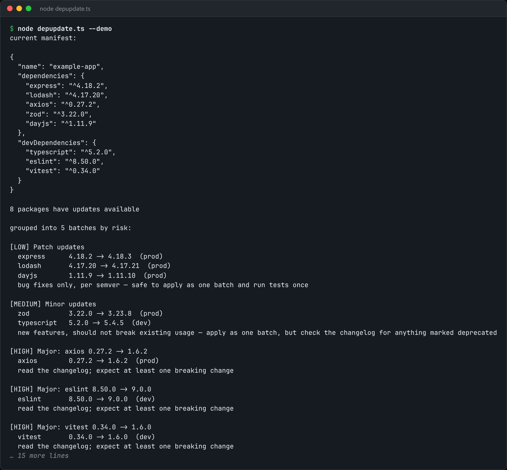

# Dependency Updates

Group dependency updates by risk and apply them one batch at a time.



*Real output of `node depupdate.ts --demo`.*

## Features

- Buckets updates by **semver distance**: patch, minor, major.
- **Patches** are proposed as one batch.
- **Each major bump** gets its own line for review, with a note when the jump is large.

## How it works

A patch bump almost never breaks you, and a major bump might. "47 packages have updates" becomes a plan instead of a wall.

## Usage

```bash
node depupdate.ts package.json --registry-cache updates.json
node depupdate.ts --demo
```

## Run it

```bash
node depupdate.ts --demo
```

Needs Node.js 22.18+ (or 23.6+), which runs TypeScript directly. It uses only `node:` built-ins, so there is no `npm install`.

## Files

| File | Purpose |
| --- | --- |
| [`depupdate.ts`](depupdate.ts) | The complete program |
| [`preview.png`](preview.png) | Captured output of a real run |
