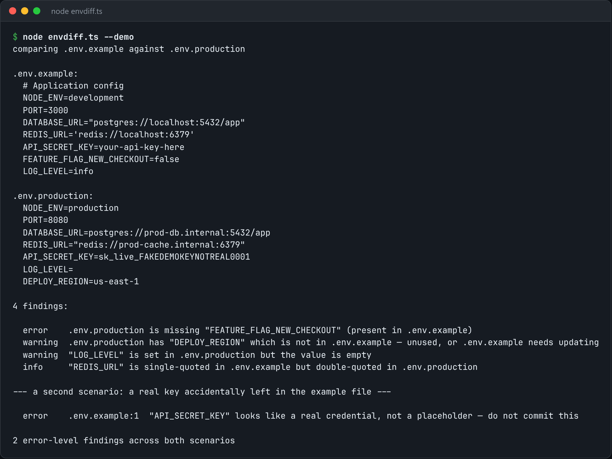

# Env Diff

Compare `.env` files across environments and flag missing, unused or suspicious keys.



*Real output of `node envdiff.ts --demo`.*

## Features

- Flags **keys missing** from an environment, which are deploys waiting to fail.
- Flags **unused** keys.
- Detects **real-looking secrets** left in example files.
- Spots **inconsistent quoting** across files.

## How it works

Each file is parsed into keys and raw values, and the sets are compared. Values are checked against secret-like patterns.

## Usage

```bash
node envdiff.ts .env.example .env.production
node envdiff.ts --demo
```

## Run it

```bash
node envdiff.ts --demo
```

Needs Node.js 22.18+ (or 23.6+), which runs TypeScript directly. It uses only `node:` built-ins, so there is no `npm install`.

## Files

| File | Purpose |
| --- | --- |
| [`envdiff.ts`](envdiff.ts) | The complete program |
| [`preview.png`](preview.png) | Captured output of a real run |
