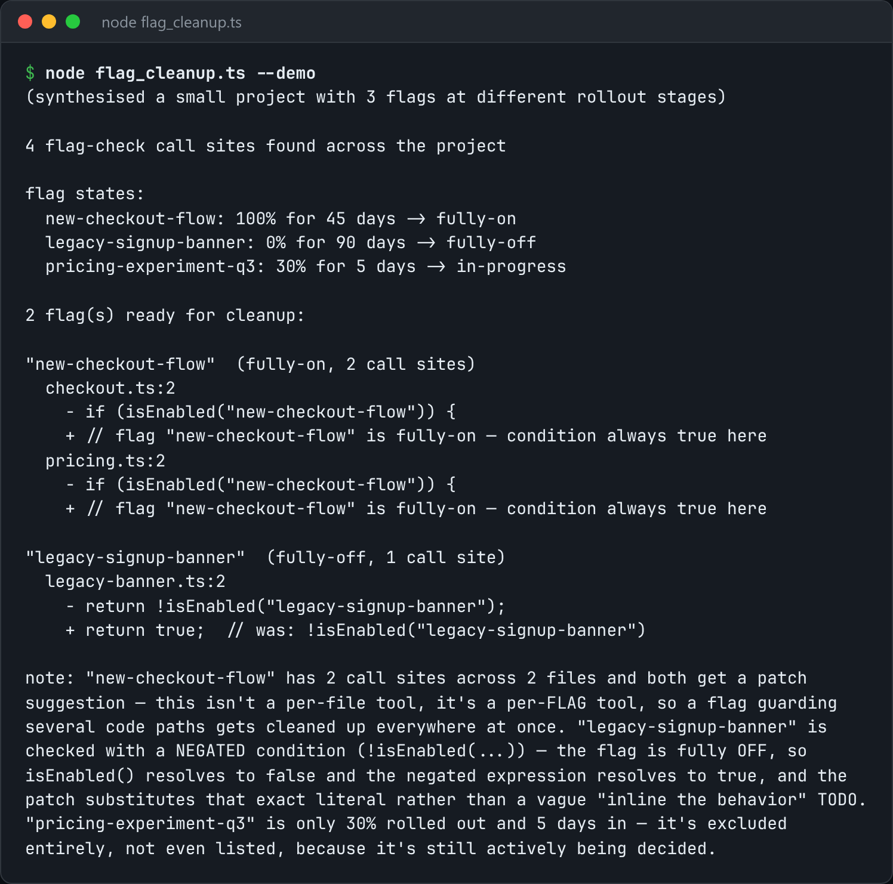

# Feature Flag Cleanup

Find feature flags that are fully rolled out or fully killed, and generate the patch that removes them.



*Real output of `node flag_cleanup.ts --demo`.*

## Features

- Scans source for **flag-check call sites**.
- Cross-references each flag's **current rollout state**.
- For a fully resolved flag, **generates the diff** that collapses the conditional to the branch that survives.

## How it works

A flag at 100% for months is dead weight, and its "disabled" branch is unreachable. This produces the patch itself, ready to review.

## Usage

```bash
node flag_cleanup.ts ./src --config flags.json
node flag_cleanup.ts --demo
```

## Run it

```bash
node flag_cleanup.ts --demo
```

Needs Node.js 22.18+ (or 23.6+), which runs TypeScript directly. It uses only `node:` built-ins, so there is no `npm install`.

## Files

| File | Purpose |
| --- | --- |
| [`flag_cleanup.ts`](flag_cleanup.ts) | The complete program |
| [`preview.png`](preview.png) | Captured output of a real run |
