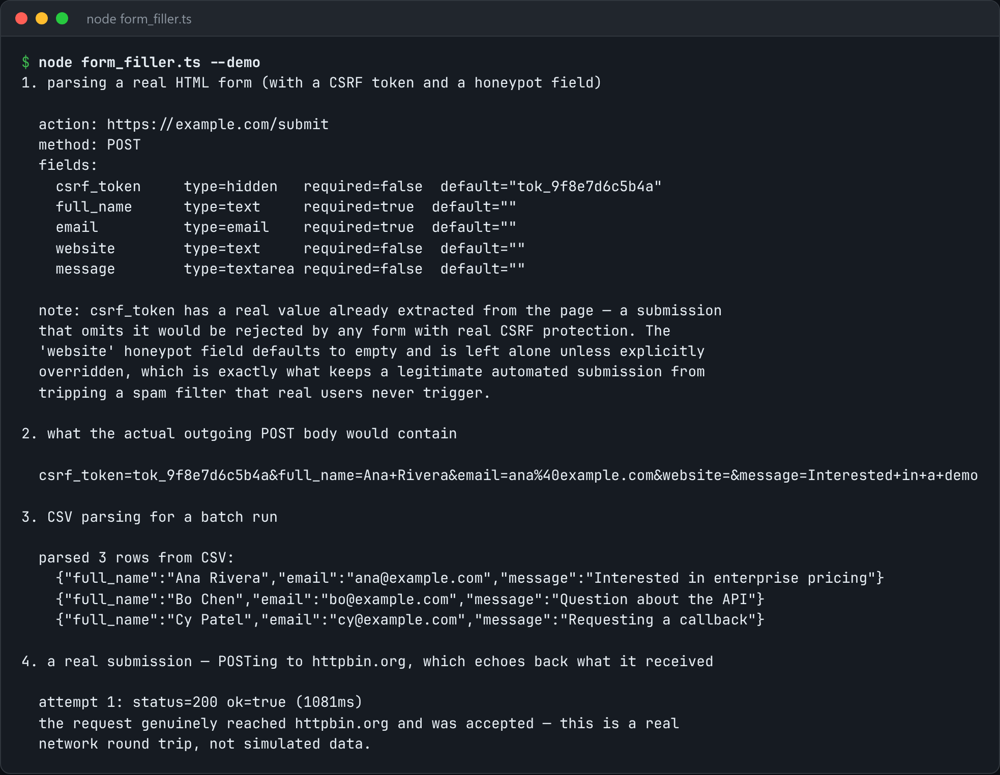

# Form Filler

Drive repetitive HTML form submissions with retries and a run log, no browser needed.



*Real output of `node form_filler.ts --demo`.*

## Features

- Parses the page's real `<form>`: **action, method and hidden fields** such as the CSRF token and honeypot.
- **Retries with backoff.**
- **Batch mode** from a CSV keeps going after one row fails.
- Writes a run log of each submission.

## How it works

A POST missing the hidden fields a browser would have sent is the main reason form scripts get rejected, so the form is read first.

## Usage

```bash
node form_filler.ts submit --url https://httpbin.org/post --data name=Ana --data role=admin
node form_filler.ts batch --url URL --csv rows.csv
node form_filler.ts --demo
```

## Run it

```bash
node form_filler.ts --demo
```

Needs Node.js 22.18+ (or 23.6+), which runs TypeScript directly. It uses only `node:` built-ins, so there is no `npm install`.

## Files

| File | Purpose |
| --- | --- |
| [`form_filler.ts`](form_filler.ts) | The complete program |
| [`preview.png`](preview.png) | Captured output of a real run |
