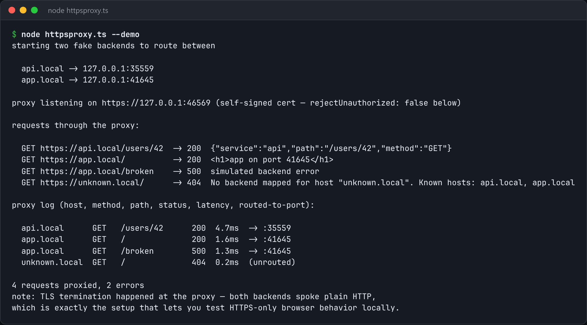

# HTTPS Dev Proxy

A local HTTPS development proxy with self-signed certs, host-based routing and request logging.



*Real output of `node httpsproxy.ts --demo`.*

## Features

- Generates a **throwaway self-signed certificate** (a one-day cert via `openssl`, deleted after loading).
- **Routes by Host header** to the mapped backend.
- **Logs** the method, path, status and latency of every request.
- `--demo` starts two fake backends and proxies both over TLS.

## How it works

Useful for testing what behaves differently over TLS (secure cookies, service workers, mixed-content blocking) without production certificates.

## Usage

```bash
node httpsproxy.ts --map api.local:3001 --map app.local:3000
node httpsproxy.ts --demo    # runs two fake backends and proxies both over TLS
```

## Run it

```bash
node httpsproxy.ts --demo
```

Needs Node.js 22.18+ (or 23.6+), which runs TypeScript directly. It uses only `node:` built-ins, so there is no `npm install`.

## Files

| File | Purpose |
| --- | --- |
| [`httpsproxy.ts`](httpsproxy.ts) | The complete program |
| [`preview.png`](preview.png) | Captured output of a real run |
