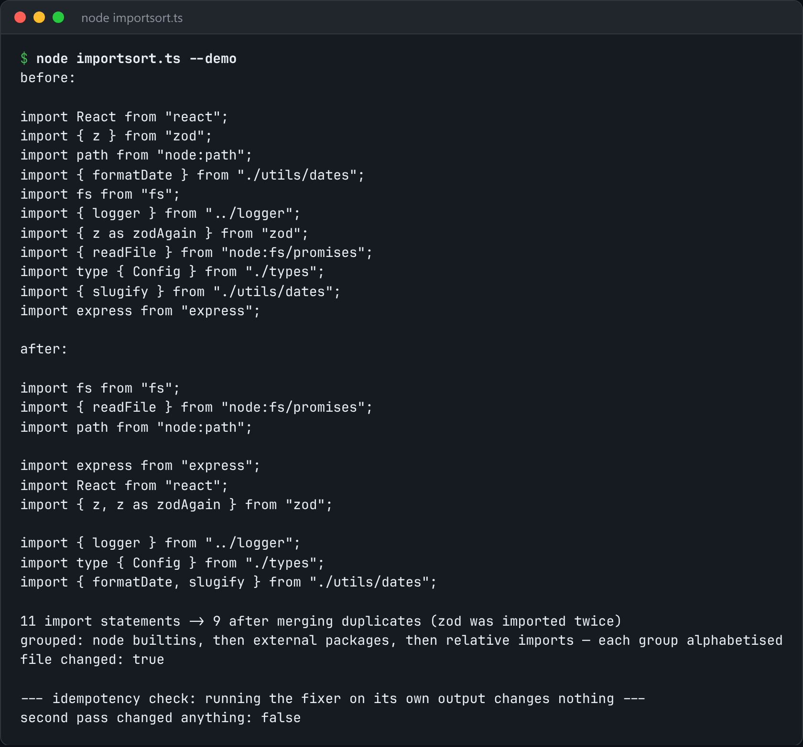

# Import Sort

Group, sort and rewrite import blocks, with no dependencies.



*Real output of `node importsort.ts --demo`.*

## Features

- **Three groups**: Node built-ins, external packages, relative imports.
- Alphabetical within each group, with a blank line between groups.
- **Named imports are sorted**, and **duplicate imports are merged**.
- `--write` rewrites the file in place.

## How it works

Import statements are tokenised with regexes rather than a full AST, which is enough for the common case. A tool that fixes the problem beats one that only complains.

## Usage

```bash
node importsort.ts src/App.tsx --write
node importsort.ts --demo
```

## Run it

```bash
node importsort.ts --demo
```

Needs Node.js 22.18+ (or 23.6+), which runs TypeScript directly. It uses only `node:` built-ins, so there is no `npm install`.

## Files

| File | Purpose |
| --- | --- |
| [`importsort.ts`](importsort.ts) | The complete program |
| [`preview.png`](preview.png) | Captured output of a real run |
