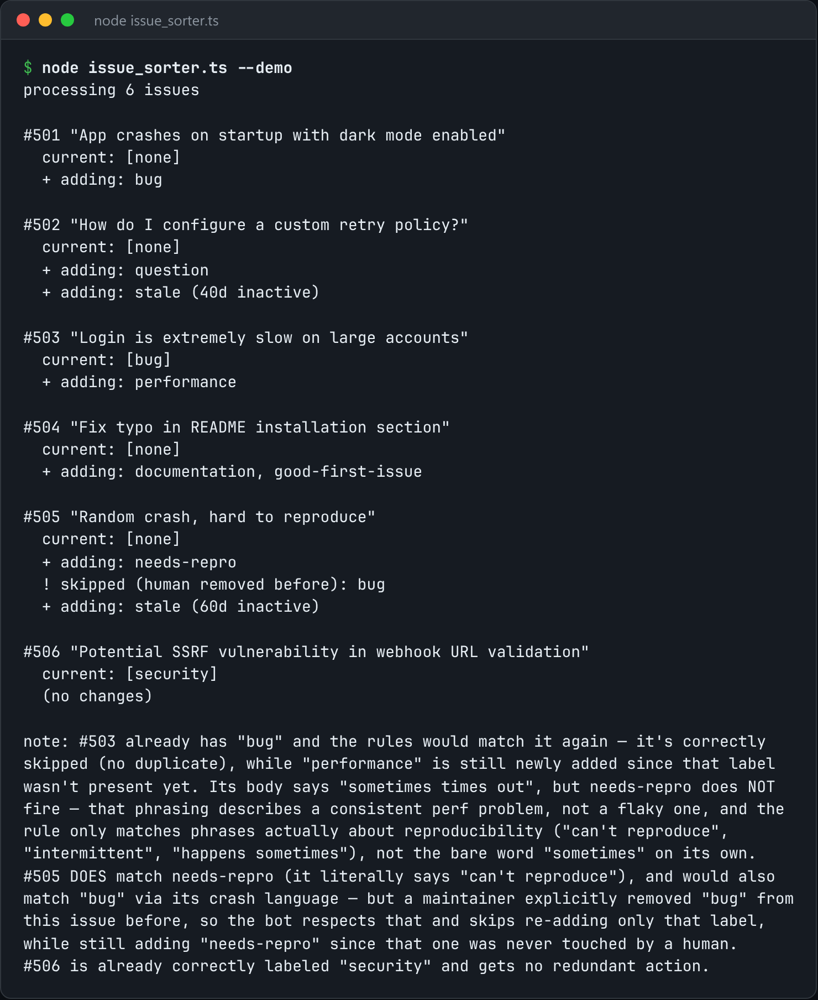

# Issue Sorter

Apply labels from title and body rules, and bring stale issues back into view.



*Real output of `node issue_sorter.ts --demo`.*

## Features

- Rules match **title and body** ("crashes" in the title, "TypeError" in the body).
- **Every matching rule applies**, so an issue can be both `bug` and `needs-repro`.
- A **"don't re-add" list** remembers labels a human removed.
- Surfaces stale issues.

## How it works

The bot never fights a maintainer: once someone removes a label, it is recorded and skipped on later runs.

## Usage

```bash
node issue_sorter.ts sort --repo org/repo --token $TOKEN
node issue_sorter.ts --demo
```

## Run it

```bash
node issue_sorter.ts --demo
```

Needs Node.js 22.18+ (or 23.6+), which runs TypeScript directly. It uses only `node:` built-ins, so there is no `npm install`.

## Files

| File | Purpose |
| --- | --- |
| [`issue_sorter.ts`](issue_sorter.ts) | The complete program |
| [`preview.png`](preview.png) | Captured output of a real run |
