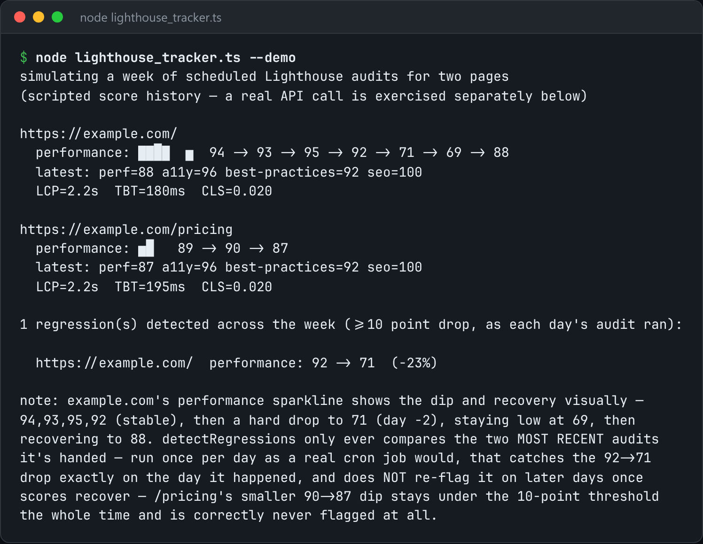

# Lighthouse Tracker

Audit key pages with the PageSpeed Insights API and chart the trend over time.



*The demo's scripted week of audits, showing a detected regression: `node lighthouse_tracker.ts --demo`.*

## Features

- Uses Google's **PageSpeed Insights API**: real Lighthouse scores, with no local Chrome.
- Keeps a **flat history file** of every audit.
- **Sparklines** per page, plus LCP, TBT and CLS.
- Flags a **regression** of 10 points or more between the two most recent audits.

## How it works

A single score is a fact, and the trend is what tells you whether last week's deploy broke something.

## Usage

```bash
node lighthouse_tracker.ts audit --urls https://example.com,https://example.com/pricing
node lighthouse_tracker.ts --demo
```

## Run it

```bash
node lighthouse_tracker.ts --demo
```

Needs Node.js 22.18+ (or 23.6+), which runs TypeScript directly. It uses only `node:` built-ins, so there is no `npm install`.

## Files

| File | Purpose |
| --- | --- |
| [`lighthouse_tracker.ts`](lighthouse_tracker.ts) | The complete program |
| [`preview.png`](preview.png) | Captured output of a real run |
