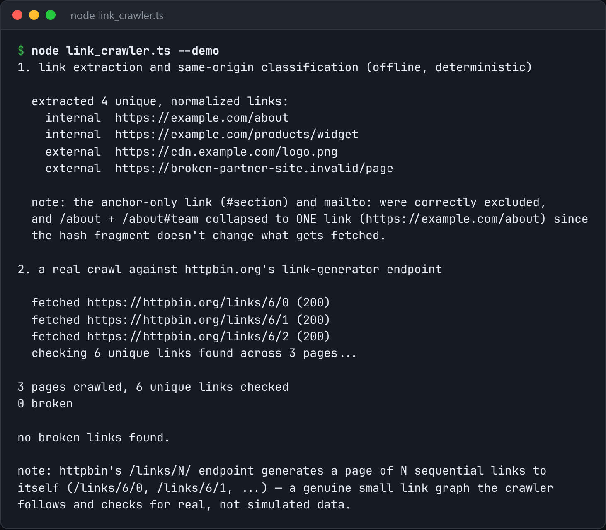

# Link Crawler

Crawl a site by following its links, and report every broken one.



*Real output of `node link_crawler.ts --demo`.*

## Features

- **Internal links are followed and checked. External links are checked with a HEAD request** and never followed.
- Each link is **checked once**, however many pages reference it.
- Findings list **every page** that has the broken link.
- `--max-pages` limits the crawl.

## How it works

The same broken CDN URL linked from 40 pages is one finding with 40 sources listed, not 40 duplicates.

## Usage

```bash
node link_crawler.ts https://example.com --max-pages 50
node link_crawler.ts --demo
```

## Run it

```bash
node link_crawler.ts --demo
```

Needs Node.js 22.18+ (or 23.6+), which runs TypeScript directly. It uses only `node:` built-ins, so there is no `npm install`.

## Files

| File | Purpose |
| --- | --- |
| [`link_crawler.ts`](link_crawler.ts) | The complete program |
| [`preview.png`](preview.png) | Captured output of a real run |
