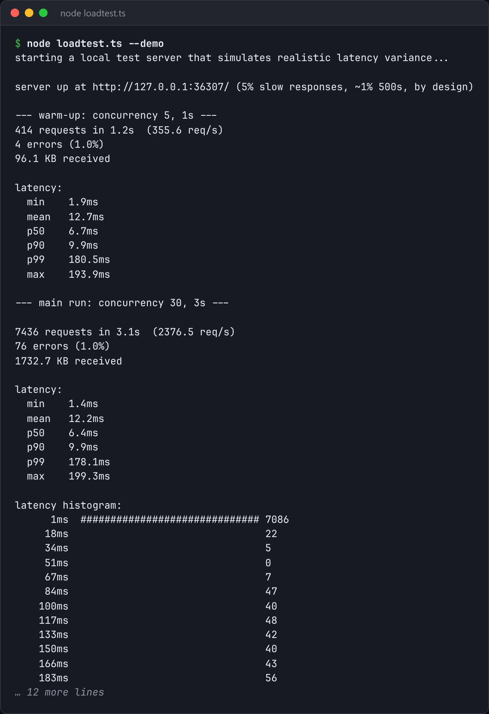

# Load Tester

An HTTP load tester with concurrency ramps, latency percentiles and a live terminal histogram.



*Real output of `node loadtest.ts --demo`.*

## Features

- A **fixed pool of workers** that fire again immediately, which is what actually saturates a server.
- **Exact p50 and p99** from a sorted array of every latency sample.
- A **latency histogram** in the terminal.
- `--demo` runs against a local test server.

## How it works

A mean can look fine while one request in a hundred takes ten seconds, so the percentiles are what it reports.

## Usage

```bash
node loadtest.ts http://localhost:8080/ --concurrency 50 --duration 5
node loadtest.ts --demo         # runs a local test server, no external target needed
```

## Run it

```bash
node loadtest.ts --demo
```

Needs Node.js 22.18+ (or 23.6+), which runs TypeScript directly. It uses only `node:` built-ins, so there is no `npm install`.

## Files

| File | Purpose |
| --- | --- |
| [`loadtest.ts`](loadtest.ts) | The complete program |
| [`preview.png`](preview.png) | Captured output of a real run |
