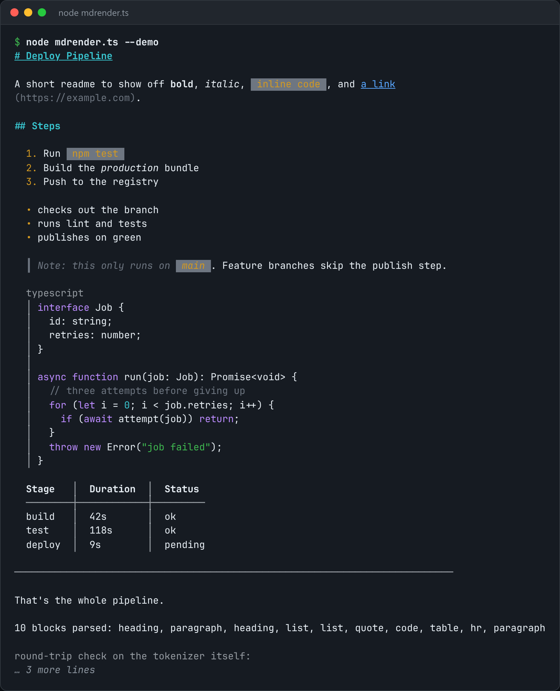

# Markdown Renderer

Render Markdown in the terminal: headings, lists, tables and syntax-highlighted code.



*Real output of `node mdrender.ts --demo`.*

## Features

- A **block-level parser**: paragraphs, headings, lists, code fences and tables.
- **Inline formatting**: bold, italic, code and links.
- A **small tokenizer per language** colours keywords, strings and comments in code fences.

## How it works

The source is split into blocks line by line, and each block is rendered with inline formatting applied.

## Usage

```bash
node mdrender.ts README.md
node mdrender.ts --demo
```

## Run it

```bash
node mdrender.ts --demo
```

Needs Node.js 22.18+ (or 23.6+), which runs TypeScript directly. It uses only `node:` built-ins, so there is no `npm install`.

## Files

| File | Purpose |
| --- | --- |
| [`mdrender.ts`](mdrender.ts) | The complete program |
| [`preview.png`](preview.png) | Captured output of a real run |
