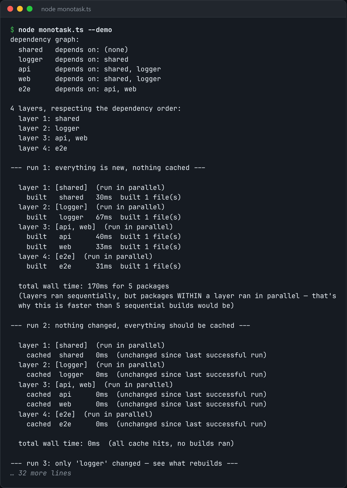

# Monorepo Task Runner

Run tasks in dependency order with caching and parallel workspaces.



*Real output of `node monotask.ts --demo`.*

## Features

- Runs tasks in **topological order**.
- **Independent packages in the same layer run in parallel.**
- **Skips a task** when a content hash of its inputs matches the last successful run.
- Cache keys **include each dependency's hash**, so a change rebuilds everything downstream of it.
- A failure stops later layers, and a **circular dependency** is caught before anything runs.

## How it works

Like a Makefile's mtime check, but keyed on what actually changed rather than when.

## Usage

```bash
node monotask.ts build
node monotask.ts --demo
```

## Run it

```bash
node monotask.ts --demo
```

Needs Node.js 22.18+ (or 23.6+), which runs TypeScript directly. It uses only `node:` built-ins, so there is no `npm install`.

## Files

| File | Purpose |
| --- | --- |
| [`monotask.ts`](monotask.ts) | The complete program |
| [`preview.png`](preview.png) | Captured output of a real run |
