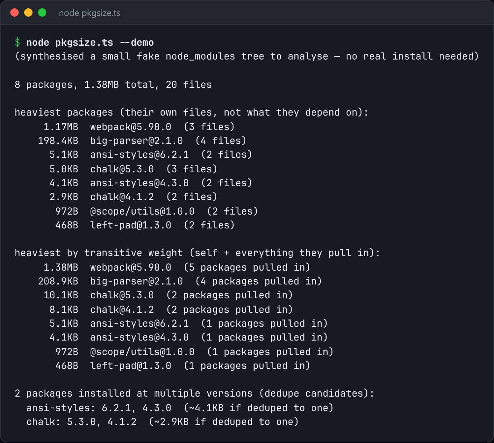

# Package Size

Report install size and the heaviest transitive dependencies of a package tree.



*Real output of `node pkgsize.ts --demo`.*

## Features

- Walks `node_modules` **on disk** and sums real bytes per package.
- Counts a package **once**, even if npm nested duplicates.
- Builds **reverse edges** to answer "who pulled this in?".

## How it works

A package can be hoisted, deduplicated or nested in several ways, so the folders on disk are the source of truth, not the manifest.

## Usage

```bash
node pkgsize.ts ./node_modules
node pkgsize.ts --demo
```

## Run it

```bash
node pkgsize.ts --demo
```

Needs Node.js 22.18+ (or 23.6+), which runs TypeScript directly. It uses only `node:` built-ins, so there is no `npm install`.

## Files

| File | Purpose |
| --- | --- |
| [`pkgsize.ts`](pkgsize.ts) | The complete program |
| [`preview.png`](preview.png) | Captured output of a real run |
