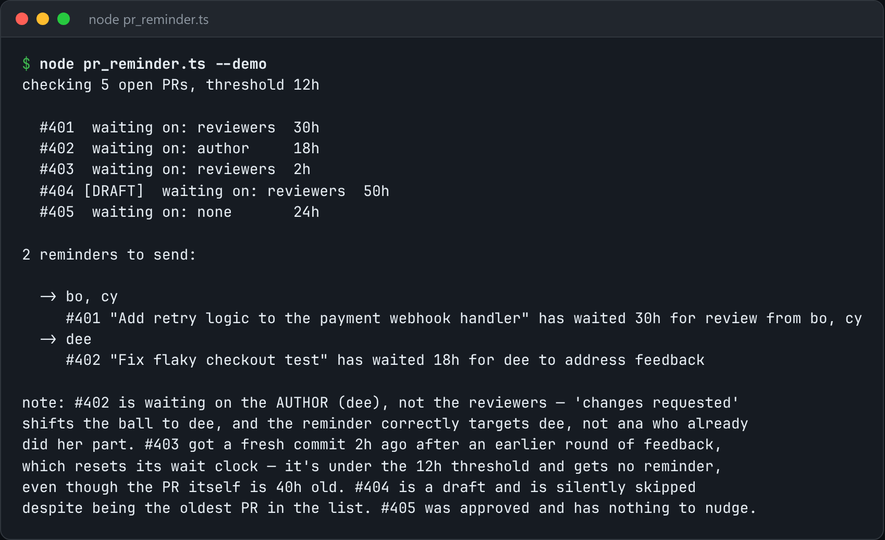

# PR Reminder

Nudge the right person about pull requests that have sat idle past a threshold.



*Real output of `node pr_reminder.ts --demo`.*

## Features

- Tracks the **last meaningful state change** of each PR: pushes, reviews and comments.
- Works out **who is waiting on whom**: reviewers owe a look, or the author owes a reply.
- Nudges only when the **waiting party** has waited past `--hours`.

## How it works

Wall-clock age since opening isn't "idle". A PR reviewed 20 minutes ago is waiting on its author, not the reviewers.

## Usage

```bash
node pr_reminder.ts check --repo org/repo --token $GITHUB_TOKEN --hours 24
node pr_reminder.ts --demo
```

## Run it

```bash
node pr_reminder.ts --demo
```

Needs Node.js 22.18+ (or 23.6+), which runs TypeScript directly. It uses only `node:` built-ins, so there is no `npm install`.

## Files

| File | Purpose |
| --- | --- |
| [`pr_reminder.ts`](pr_reminder.ts) | The complete program |
| [`preview.png`](preview.png) | Captured output of a real run |
