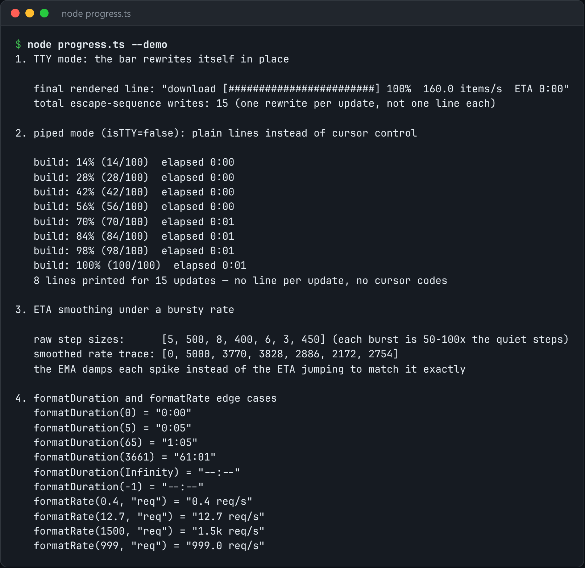

# Progress Bars

A progress bar library with multi-bar rendering, ETA maths, and correct behaviour when piped.



*Real output of `node progress.ts --demo`.*

## Features

- **Detects `isTTY`**: rewrites in place on a terminal, and prints periodic plain lines when piped.
- **Smooths the rate with an EMA**, so the ETA doesn't jump on bursty work.
- **Multiple bars** at once.
- `formatDuration` and `formatRate` helpers that handle edge cases.

## How it works

Homemade bars often write cursor codes into log files and show jittery ETAs. Both are handled here.

## Usage

```bash
node progress.ts --demo
```

## Run it

```bash
node progress.ts --demo
```

Needs Node.js 22.18+ (or 23.6+), which runs TypeScript directly. It uses only `node:` built-ins, so there is no `npm install`.

## Files

| File | Purpose |
| --- | --- |
| [`progress.ts`](progress.ts) | The complete program |
| [`preview.png`](preview.png) | Captured output of a real run |
